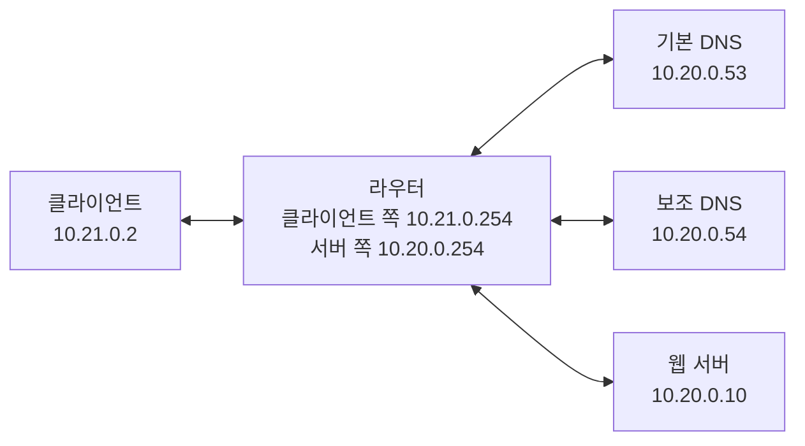

# 양시찬 실험망 작업 내역

작성일: 2026년 11월 6일

**현재까지 만든 것은 AI가 네트워크 고장 원인을 맞혀 볼 수 있는 실제 시험장이다.** 사이트가 정상적으로 열리는 환경을 만들고, 서로 다른 두 가지 고장을 일부러 발생시킨 뒤, 증거를 저장하고 원래 상태로 복구할 수 있게 했다.

현재 완료 범위는 **첫 통합 시연에 필요한 D2와 T2 장애**다. 나머지 장애와 실제 AI 모델 연결은 후속 작업이다.

## 1. 내가 맡은 부분

프로젝트에서는 네 사람이 다음 역할을 맡는다.

| 담당 | 역할 | 쉽게 말하면 |
|---|---|---|
| 김승범 | Breaker | 어떤 고장을 낼지 정하는 출제자 |
| **양시찬** | **실험망** | **출제자가 정한 고장을 실제로 만들고 되돌리는 시험장 담당** |
| 이현섭 | Diagnoser | 검사 결과를 보고 고장 원인을 찾는 AI 구현 |
| 김세중 | 심판과 통합 | 순서를 진행하고 정답과 진단을 비교하는 프로그램 구현 |

이번에 한 일은 실험망과 장애 조작, 패킷 캡처, 복구 기능을 만드는 것이다. 심판과 Diagnoser가 정해진 방식으로 실험망을 사용할 수 있도록 기존 데이터 형식도 유지했다.

## 2. 이전 상태와 지금 상태

| 항목 | 작업 전 | 작업 후 |
|---|---|---|
| 네트워크 환경 | 실제 실험망 없음 | Docker 컨테이너 5개로 구성 |
| 장애 주입 | MockLab이 장애 목록만 기억 | 실제 DNS 설정과 방화벽 규칙 변경 |
| 재현 확인 | 모의 결과 반환 | 클라이언트에서 DNS와 접속 결과 측정 |
| 증거 | 미리 작성한 예시 출력 | 실제 명령 출력과 패킷 파일 저장 |
| 복구 | 모의 장애 목록 삭제 | DNS·방화벽 복구와 캡처 프로세스 종료 |
| 실행 방법 | 모의 demo | 실제 검사 명령 lab-check 추가 |

**MockLab**은 다른 팀원이 실험망 없이 심판을 개발할 수 있도록 만든 모의 구현이다. **DockerLab**은 이번에 추가한 실제 구현이다. 두 구현은 같은 네 함수를 제공한다.

## 3. 실험망이 어떻게 생겼는가

Docker는 프로그램을 실행 환경과 함께 컨테이너에 담아 돌리는 도구다. 이번에는 아래 다섯 개를 사용한다.



- **클라이언트:** 사용자 컴퓨터 역할이다. 접속 검사와 캡처는 여기에서 실행한다.
- **라우터:** 클라이언트와 서버 사이에서 패킷을 전달한다. 나중에 지연이나 손실을 재현할 때도 필요하다.
- **기본 DNS:** shop.lab 같은 이름을 IP 주소로 바꿔 준다. D2 장애에서는 이 응답을 바꾼다.
- **보조 DNS:** 기본 DNS의 답과 비교할 수 있도록 정상 주소를 제공한다.
- **웹 서버:** 정상일 때 HTTP 200을 반환한다. HTTP 200은 요청을 정상적으로 처리했다는 뜻이다.

클라이언트와 서버를 다른 네트워크에 두어 요청과 응답이 라우터를 거치게 했다. 도메인은 shop.lab과 news.lab을 사용한다. 라우터 주소는 Docker의 기본 게이트웨이와 겹치지 않도록 각 대역의 .254로 정했다.

## 4. 구현한 두 가지 장애

두 경우 모두 사용자에게는 “사이트가 열리지 않는다”는 같은 증상으로 보인다. 실제 원인은 서로 다르다.

| 항목 | D2 잘못된 DNS 주소 | T2 TCP 연결 거부 |
|---|---|---|
| 비유 | 주소 안내가 잘못되어 엉뚱한 곳에 감 | 주소는 맞게 찾아갔지만 연결을 거절당함 |
| 실제 변경 | 기본 DNS가 shop.lab을 10.20.0.99로 안내 | 웹 서버 80번 포트에 연결 거부 규칙 적용 |
| 기본 DNS 응답 | 잘못된 주소 .99 | 정상 주소 .10 |
| 접속 결과 | 실패 또는 시간 초과 | 연결 거부 |
| 확인하는 증거 | 기본·보조 DNS 답 비교, 정상 IP 강제 접속 성공 | 정상 DNS 답, 연결 거부 출력, RST 패킷 |

**D2의 확인 방법:** 기본 DNS는 .99를 주고 보조 DNS는 .10을 주는지 비교한다. DNS를 거치지 않고 정상 IP를 지정해 요청하면 HTTP 200이 나오는지도 확인한다. 이 결과로 웹 서버가 살아 있고 주소 안내에 문제가 있음을 확인한다.

**T2의 확인 방법:** DNS가 정상 IP를 주는지 확인한 다음 접속을 시도한다. 웹 서버의 방화벽은 연결을 거부하는 RST 패킷을 보낸다. RST는 TCP 연결을 끊거나 거부할 때 사용하는 신호다.

처음부터 16종을 모두 만들기보다 이 두 장애로 주입·관측·복구의 전체 흐름을 먼저 검증했다. 두 장애는 팀 문서의 첫 통합 목표이기도 하다.

## 5. 한 번 실행하면 무슨 일이 일어나는가

```text
시나리오 형식 검사
  → 정상 접속 확인
  → 시작 전에 장애가 남아 있으면 초기화하고 다시 확인
  → 지정한 장애 주입
  → DNS·접속 결과와 패킷 캡처로 재현 확인
  → 캡처 종료, DNS와 방화벽 복구
  → 원래 URL로 정상 접속 확인
  → 기록 저장
```

심판이 실험망을 다루는 함수는 네 개다.

| 함수 | 하는 일 |
|---|---|
| health_check | 원래 URL에 접속해 HTTP 200인지 확인 |
| inject | D2 또는 T2 장애 적용 |
| verify_symptom | 의도한 장애가 실제로 나타났는지 확인하고 증거 수집 |
| reset | 캡처 프로세스를 종료하고 DNS와 방화벽을 원복 |

접속이 실패했다는 이유만으로 장애 재현에 성공했다고 판정하지 않는다. DNS 답, 정상 IP로 직접 접속한 결과, RST 등 장애별 기대 결과를 함께 확인한다. 주입이나 검사에 실패해도 복구를 실행하며, 복구가 확인되지 않으면 다음 시나리오를 진행하지 않는다.

## 6. 검토하면서 고친 부분

검토 전용 에이전트가 코드를 독립적으로 읽고, 주 작업에서는 실제 Docker 실행으로 문제를 확인했다. 수정 후 다시 검토했다.

| 발견한 문제 | 수정한 내용 | 필요한 이유 |
|---|---|---|
| 시간 초과 후 컨테이너 안에서 캡처가 계속 실행됨 | 캡처 작업들을 묶어 종료하고 종료 여부 확인 | 이전 검사가 다음 검사에 남지 않게 함 |
| 캡처 파일만 있고 패킷 번호와 총 개수가 없음 | 원본 pcap 번호와 총 개수 기록 | 실제 패킷을 근거로 인용할 수 있게 함 |
| 시작 전에 장애가 남으면 바로 실패로 종료 | 초기화 후 정상 확인 재시도 | 이전 실행이 중단돼도 다시 실행할 수 있게 함 |
| DNS 설정 변경 명령만 성공하면 적용됐다고 판단 | 실제 DNS 응답이 기대 IP인지 확인 | 설정이 반영되기 전에 검사를 시작하는 문제 방지 |
| 명령 시간 초과 때 수집한 출력이 사라짐 | 중단 전 표준 출력과 오류 출력 보존 | 실패 원인을 추적할 수 있게 함 |
| URL의 포트 0을 기본 포트로 취급 | 포트 0 거부 | 잘못된 입력을 실행 전에 막음 |
| 이미지에 tracepath가 없음 | 도구 설치 | 후속 경로 검사 준비 |

## 7. 어떻게 검증했는가

구현 검증 때 **전체 테스트 63개가 통과**했다. 이 중 Docker 실험망을 사용하는 통합 검사는 5개다.

- D2가 실제로 나타나고 복구되는지 확인했다.
- T2가 실제로 나타나고 복구되는지 확인했다.
- 기존 심판이 실제 DockerLab을 호출하는지 확인했다. 이 검사에서 진단은 저장된 예시를 재생했다.
- 캡처를 일부러 시간 초과시킨 뒤 캡처 프로세스가 남지 않는지 확인했다.
- 실제 장애를 적용한 다음 명령 실패를 보고하도록 만들어, 심판이 실험망을 복구하는지 확인했다.

별도로 T2 장애가 남은 상태에서 lab-check를 시작해 자동 복구를 확인했다. 이어 D2와 T2를 각각 3회씩 실행했으며 **6회 모두 재현과 정상화에 성공**했다.

해당 반복 기록은 로컬의 `runs/lab-check-20261106-151103-218782.jsonl`에 있다. 테스트와 반복 실행은 이번 구현 과정에서 수행한 결과이며, 다른 팀원 컴퓨터에서의 재실행은 아직 확인하지 않았다.

## 8. 직접 실행하는 방법

Docker Desktop 또는 Docker Engine을 켜고 저장소 루트에서 실행한다. Python은 3.10 이상을 사용한다.

### 실험망 시작과 검사

```bash
docker build -t netrunner-lab ./lab
docker compose up -d --no-build
python3 -m netrunner lab-check --repeat 3
```

각각 성공하면 아래처럼 출력된다. --repeat 3이면 두 시나리오를 세 번씩 검사한다.

```text
FI-01: 성공
FI-02: 성공
FI-01: 성공
FI-02: 성공
FI-01: 성공
FI-02: 성공
기록: .../runs/lab-check-날짜-시간.jsonl
```

### 테스트 실행

pytest가 설치된 Python 환경에서는 다음 명령을 쓴다.

```bash
NETRUNNER_INTEGRATION=1 python3 -m pytest tests -q
```

개발 중에는 설치된 uv를 이용해 다음 명령으로 실행했다. uv가 pytest를 실행 환경에 준비하므로 별도의 수동 설치가 필요하지 않았다.

```bash
NETRUNNER_INTEGRATION=1 uv run --with pytest --no-project pytest -q
```

NETRUNNER_INTEGRATION=1을 빼면 실제 Docker 검사는 건너뛴다. Docker가 켜져 있고 실험망 컨테이너도 실행 중이어야 통합 검사를 할 수 있다.

### 종료

```bash
docker compose down
```

컨테이너를 종료해도 이미 저장한 runs와 captures 파일은 남는다.

## 9. 결과 파일은 어떻게 읽는가

| 위치 | 내용 | 확인 방법 |
|---|---|---|
| runs/*.jsonl | 실행 단계별 성공 여부와 측정 결과 | 텍스트 편집기로 열어 한 줄씩 확인 |
| captures/*.pcap | 실제로 오간 패킷 | Wireshark 등 패킷 분석 도구로 열기 |

JSONL은 한 줄에 JSON 기록 하나를 저장한 형식이다. lab-check에서는 한 줄이 시나리오 실행 한 번에 해당한다.

기록의 steps에서 아래 항목의 ok가 true인지 확인하면 된다.

```text
health_check        처음 정상 접속이 됐는가
inject              장애 적용에 성공했는가
verify_symptom      기대한 장애가 나타났는가
reset               복구 작업이 끝났는가
health_check_after  복구 후 같은 URL이 정상인가
```

시작 상태를 복구한 경우에는 health_check_initial과 reset_before도 기록된다. 초기 검사가 실패했더라도 복구 후 나머지 단계가 성공하면 최종 실행은 성공할 수 있다.

verify_symptom의 observations.capture에는 다음 정보가 들어간다.

| 필드 | 의미 |
|---|---|
| stdout | tcpdump가 출력한 원본 텍스트 |
| output | 원본 패킷 번호를 #1, #2처럼 표시한 텍스트 |
| packets | 캡처의 총 패킷 수 |
| file | 로컬 pcap 파일 경로 |
| cleanup | 캡처 프로세스 정리 결과 |

## 10. 코드를 읽을 때 볼 파일

| 파일 | 읽는 목적 |
|---|---|
| [compose.yaml](../compose.yaml) | 컨테이너 5개와 네트워크 주소 확인 |
| [lab/start.sh](../lab/start.sh) | 컨테이너가 시작할 때 경로·DNS·웹을 준비하는 과정 |
| [netrunner/docker_lab.py](../netrunner/docker_lab.py) | 네 가지 Lab 함수와 장애별 성공 판정 |
| [lab/capture.sh](../lab/capture.sh) | 패킷 캡처와 번호가 있는 출력 생성 |
| [lab/stop-capture.sh](../lab/stop-capture.sh) | 중단된 캡처를 종료하고 확인하는 과정 |
| [config/lab.json](../config/lab.json) | 도메인·IP·지원 장애 목록 |
| [netrunner/__main__.py](../netrunner/__main__.py) | lab-check 명령의 실행 순서 |
| [tests/test_docker_lab.py](../tests/test_docker_lab.py) | 정상 실행과 실패·복구 검증 사례 |

전체 일정은 [구현 계획](plan-Yang.md), 팀원 간 데이터 형식은 [인터페이스 문서](interfaces.md)를 참고한다.

## 11. 아직 남은 일과 사용 범위

현재 지원 범위는 **허용된 실험망 도메인의 HTTP 80번 포트, 단일 D2 또는 T2 장애**다. 실험망 하나에는 검사 명령을 한 번에 하나만 실행한다. 두 명령을 동시에 실행하면 같은 DNS 설정과 캡처 상태를 바꿀 수 있다.

다음 작업은 계획에 따라 진행한다.

1. D1·D3·N1·S1·H1 등 다음 단일 장애를 추가하고, 각각 재현과 복구를 확인한다.
2. 이현섭 담당의 실제 검사 도구와 캡처 결과를 연결한다. 검사 ID와 패킷 번호를 Probe 형식에 맞춘다.
3. 실제 AI 진단과 김세중 담당의 채점을 연결한다.
4. 단일 장애가 안정되면 복합 장애와 고정 시나리오 세트로 넓힌다.
5. 다른 팀원 컴퓨터에서 재실행하고 발표용 시연을 준비한다.

lab-check는 실험망 검증용이며 AI의 진단 성능을 측정하지 않는다. demo도 저장된 진단을 재생하는 모의 실행이므로 실제 AI 정확도 결과로 사용하면 안 된다. 에이전트의 검사 도구 접근 제한은 실제 Diagnoser를 연결할 때 구현해야 한다.

## 12. Git에 반영된 상태

- 작업 브랜치: Sichan
- 구현 커밋: 01f9d45 — 실제 Docker 실험망과 D2·T2 장애 재현 구현
- 구현 코드는 origin/Sichan에 push했다.
- 임시로 만든 feature/yang-docker-lab 브랜치는 로컬과 원격에서 삭제했다.
- runs와 captures의 실제 실행 결과는 .gitignore에 의해 Git에 올라가지 않는다. 다른 컴퓨터에서는 검사를 다시 실행해 생성한다.

이 작업 내역 문서는 구현 커밋 이후에 추가한 설명 문서다.
